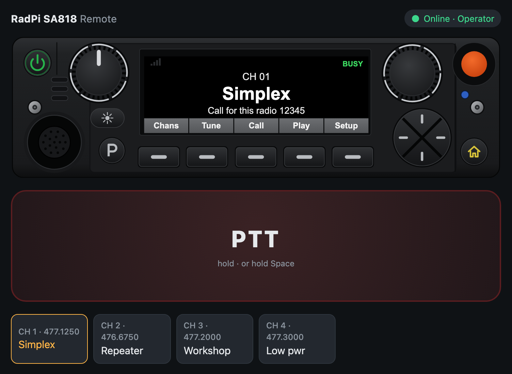
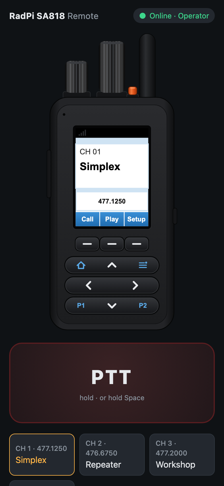
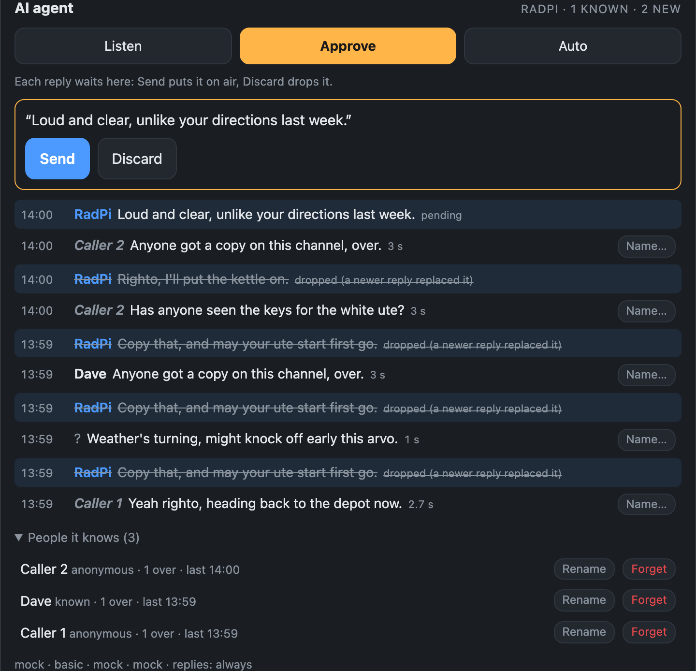

# RadPi

RadPi puts a two-way radio on the web. A Raspberry Pi sits next to a radio, or carries its own
transceiver on a HAT, and anyone with a browser can listen, talk and run the radio from
anywhere, on a phone or a PC.

- **Remote operation:** receive audio and push-to-talk with low-latency WebRTC audio. Change
  channels or tune frequencies on a radio-style control head (a desk head on wide screens, a
  handheld on phones).
- **Two hardware options:**
  - The **RadPi Control HAT** drives an existing radio through its mic connector. It works with
    most land-mobile and UHF CB radios.
  - The **RadPi SA818 HAT** has a built-in 1 W UHF transceiver, with frequencies, CTCSS/DCS,
    a VFO and signal strength.
- **On-air tools:** selcall (send and decode), audio clips played to air, text to speech in a
  choice of voices (Australian male and female included), recording of the channel, voice
  effects, and TX tone control.
- **AI agent (optional):**
  - It transcribes the channel and recognises who's talking.
  - It learns new voices and names, and keeps notes on people.
  - It can banter on air in a persona and voice you choose, including an Australian one you
    train yourself.
  - The models can run on the Pi, on an AI HAT+ 2, or in the cloud.
- **Several operators, safely:** personal accounts with control or listen-only roles, an audit
  log, and one transmitter at a time. Transmit time-outs drop PTT if a browser goes quiet.
- **Open source:**
  - Software: GPL-3.0.
  - Hardware: CERN-OHL-S. Both HATs are KiCad projects with JLC-ready parts.
  - Mock radio and audio backends let you try it all on a laptop.

<p align="center">
  
  
</p>

There are two hardware modes, set with `radio.type` in `config.yaml`:

| `radio.type` | Hardware | Channels |
|---|---|---|
| `buttons` (default) | An external radio through the **[RadPi Control HAT](pihat/)** (or hand-wired optos, [docs/HARDWARE.md](docs/HARDWARE.md)) | The radio's own channels, stepped with UP/DOWN presses |
| `sa818` | The **[RadPi SA818 HAT](sa818s-hat/)**: a 1 W UHF transceiver on the HAT, no external radio | A frequency/tone list in `config.yaml`, set over the module's serial port, plus direct frequency entry. Shows signal strength (RSSI) |

```
 Browser (phone / PC)                     Raspberry Pi                      Radio  
┌───────────────────┐   WebSocket    ┌──────────────────────┐  GPIO+opto  ┌──────────┐
│ PTT / CH▲▼ / list │◄──────────────►│ server (Python)      │────────────►│ PTT UP DN│
│ mic ─► Opus       │  JSON control  │  - PTT safety timers │  USB audio  │ MIC in   │
│ speaker ◄─ Opus   │◄══════════════►│  - channel tracking  │◄───────────►│ SPK out  │
│                   │ WebRTC (UDP)   │                      │             │          │
└───────────────────┘                └──────────────────────┘             └──────────┘
```

## Features

- Hold-to-talk button (mouse, touch or **Space** key). Mic audio streams to the radio.
- Low-latency audio over WebRTC (Opus over UDP), with automatic fallback to audio over the WebSocket.
  Settings shows the round trip and receive buffer.
- Receive audio with an RX level meter and a BUSY indicator.
- Channel ▲/▼ and jump-to-channel. The Pi presses UP/DOWN the right number of times.
- Channel names are set in config.
- Selcall: send 1-20 digit sequential tone calls from the radio face, and see calls heard on
  the channel. See [Selcall](#selcall).
- Audio clips: upload MP3s (or any audio the browser can play), pick one, and transmit it with
  the radio's Play key. See [Audio clips](#audio-clips).
- Say (off until you switch it on): type something, pick a voice, and the Pi speaks it on air.
  See [Say (text to speech)](#say-text-to-speech).
- Voice effects: Vader, Dalek, Demon, Robot, Giant, Female, Chipmunk and Ghost, switched on
  and off with the radio's P key. See [Voice effects](#voice-effects).
- Recording: the orange button records what the radio hears into 15-minute parts, which join the
  clip list. See [Recording](#recording).
- AI agent (off until you switch it on): transcribes the channel, recognises voices, learns new
  people, and can banter on air in a persona and voice of your choosing. See [AI agent](#ai-agent).
- A radio-style control head: a desk head on wide screens and a portrait handheld on phones.
  See [Control head](#control-head).
- With the RadPi SA818 HAT: frequencies, repeater offsets and CTCSS/DCS per channel, a VFO for any
  frequency in the band, and an RSSI bar on the display.
- Several operators can listen at once. Only one can transmit, and the others see who's on air.
- Personal accounts with **control** (everything) or **listen** (hear only) roles, an audit log of
  who did what, and login lockout. See [Accounts and security](#accounts-and-security).
- Safety features:
  - Server-side transmit time-out (`max_tx_seconds`).
  - PTT drops if the browser goes quiet (network loss, closed tab, phone locked).
  - PTT drops if the browser window loses focus.
  - No channel changes while transmitting.
  - GPIO pins stay low at boot.
- Mock GPIO and mock audio, so you can develop on a laptop without the radio.

## Try it on your laptop (no hardware)

```bash
cd radpi
python3 -m venv .venv && source .venv/bin/activate
pip install -r requirements.txt
cp config.example.yaml config.yaml
#  in config.yaml set: gpio.backend: mock, audio.backend: mock
python -m server.users -c config.yaml add me --role control    # asks for a password
python -m server -c config.yaml
```

Open <http://localhost:8080>. `localhost` counts as secure, so the mic works.
You'll hear a test tone burst every 10 s, and PTT/channel presses show in the server log.
Set `radio.type: sa818` to try the SA818S mode: the mock module answers commands and reports a wandering RSSI.
The mock audio also plays a received selcall (to `selcall.my_id`, or 12345) every 30 s.
Set `audio.backend: sounddevice` to use your laptop's own mic and speakers as a pretend radio.

## Control head

The top of the page is drawn as a radio. Wider screens get a desk control head and phones
(600 px and narrower) get a handheld. Both show the channel, name, frequency, TX with the
time-out countdown, BUSY, RSSI and signal bars.

| Control | Does |
|---|---|
| Channel knob (right on the desk head, the tall one on the handheld) | Picks a channel. The channel shows straight away in amber and is sent once you stop turning. |
| D-pad up / down | One channel up or down |
| Volume knob | Speaker volume, the same as the slider |
| Soft keys | Call (send the selcall number, or open the Selcall panel if none is entered), Play (transmit the picked audio clip; it shows Stop while a clip is on air), Chans (channel list, desk only), Tune (SA818) or Sync (button radios; desk only while clips are on), Setup (Settings) |
| Menu (handheld) | Settings |
| P (desk), P1 (handheld) | Switch the voice effect picked in the Voice effects panel on or off. The display shows FX while it's on. |
| Power (desk), held 1.5 s | Disconnect |
| Orange button (desk: top right; handheld: on top by the antenna) | Record: starts or stops recording received audio. While recording, any other control except the volume knob also stops it (and does nothing else). See [Recording](#recording). |

Knobs turn by dragging or with the mouse wheel. The handheld's top knobs roll with a swipe
across them. A focused knob also takes the arrow keys. PTT stays a separate button (or Space),
because neither head has one on its face.

The artwork is generated. Change `assets/control-head/build_template.py` (desk) or
`build_handheld.py` (handheld), then run them; they need `rsvg-convert` for the PNGs:

```bash
python3 assets/control-head/build_template.py && python3 assets/control-head/build_handheld.py
```

They write the app's SVGs and `radio_config.js` to `web/control-head/`, and PNG layers,
layout JSON and standalone test pages to `assets/control-head/output/`. The input handling,
`web/control-head/control_head.js`, is hand-written and shared by both templates.

## Selcall

Sequential tone calls of 1 to 20 digits, in the CCIR (100 ms tones), ZVEI-1 (70 ms) or EEA (40 ms)
standard (`selcall.standard`). Set `selcall.tone_ms` to run the standard's frequencies at another
tone length, such as CCIR at 50 ms. The decoder still hears calls with longer tones than that.
A digit that repeats the one before it is sent as the repeat tone.

- **Sending:** type the number in the Selcall panel, or tap a preset or an earlier call, then
  press the **Call** soft key. The Pi keys the radio, waits
  `tx_delay_ms` for the transmitter to come up, plays the tones into the mic line and unkeys.
  PTT is locked out while a call goes out, and a call can't start while anyone transmits.
- **Receiving:** the Pi watches the received audio for selcalls. Calls show on the head's bottom
  line, as a notice, and in the panel's list. A call to this station's `selcall.my_id` is
  highlighted and plays a short chime. Sequences shorter than `decode_min_digits` are ignored,
  so speech doesn't set it off. The decoder accepts tones up to about 2% off frequency.

The tones go out through the same audio path as voice, so `audio.tx_gain` and the sound card's
mixer apply (but not the TX tone control below, which would change their levels). Set `selcall.level` so the tones give normal deviation, about the same as speech.
Write selcall numbers in the config in quotes (`my_id: "01234"`), so leading zeros are kept.

## Audio clips

Recordings kept on the Pi and sent on air from the control head: a net opening, an ID, a test
message.

- **Adding:** in the Audio clips panel, press **Upload audio…** and choose one or more files.
  The browser converts each one itself (MP3, M4A, WAV, OGG: anything it can play), to mono at
  the wire rate, trims silence off the ends and uploads it. The Pi needs no audio codecs. Clips
  are limited to `clips.max_seconds` (60 s) and `clips.max_files` (50), and are shared by every
  operator.
- **Sending:** pick a clip, then press the **Play** soft key. The Pi keys the radio, waits
  `tx_delay_ms`, plays the clip and unkeys. While it plays, the key reads **Stop**, and any
  operator can press it to cut the clip off. PTT and selcalls are locked out meanwhile, and a clip
  can't start while anyone transmits. The transmit time-out still applies.
- **Level:** every clip is played with its peak at `clips.level`, so loud and quiet recordings
  go out alike. Like voice, it then goes through `audio.tx_gain` and the sound card's mixer.

The files are kept in `clips.dir` (`/opt/radpi/clips` on an install), as WAV files with
a `clips.json` list. `update.sh` leaves them alone. **Listen** next to a clip plays it in the
browser, where you can also save it. **Rename** gives a clip or recording a new name (up to
40 characters) for everyone; the file on the Pi keeps its ID, so nothing else changes.

## Recording

Press the orange button on the radio (or **Record** in the Audio clips panel) to record the
channel. Press it again to stop. While recording, pressing any other control except the
volume knob also stops it, and that press does nothing else.

- The display shows **REC**, and the panel shows the time so far and who started it.
- **Two modes**, picked with the tick box under the record bar before you start (the orange
  button uses the same setting; `record.mode` sets the default):
  - **Continuous:** everything, silence included.
  - **Only while the channel is active (VOX):** just the overs, back to back with a short gap
    (`vox_gap_ms`, 0.3 s) instead of the silence between them. "Active" means the busy line, or
    the RX level above `audio.busy_threshold_dbfs` without one, or us transmitting. Each over
    keeps `vox_preroll_ms` (0.5 s) from before it started, so the first syllable isn't lost, and
    recording runs on for `vox_hang_ms` (2 s) after it, so short pauses don't chop it up. The bar
    shows how much has been captured.
- **Both sides of the conversation.** While the radio is keyed its receiver is muted, so the
  recording takes what we send instead: voice (after any voice effect), selcalls and clips,
  copied from the sound card output in step with the received audio, at speech level whatever
  `audio.tx_gain` is. Turn this off with `record.include_tx: false`.
- Recordings are split into parts of `record.max_minutes` (15) of audio. When a part is full it
  joins the clip list as "Recording 08 Nov 14:05:00" and the next part starts with no gap.
  Stopping finishes the part in progress. In VOX mode a part is also finished after
  `vox_close_idle_minutes` (10) of quiet, so the overs so far appear in the list.
- It runs on the Pi, so it carries on with no one connected. It also carries on after a restart,
  and a part cut short by a power failure is recovered into the list.
- Storage: about 115 MB an hour. Once recordings pass `record.keep_mb` (2000 MB, about 17
  hours), the oldest are deleted. Uploaded clips are never deleted automatically. Recording
  stops, with a notice, if the disk gets down to `record.min_free_mb`.
- A recording can be played on air like any clip if it fits inside `ptt.max_tx_seconds`.
  Longer ones can't be picked, but you can still listen to and save them.

## Say (text to speech)

Type something in the **Say** panel, pick a voice and press **Say on air** (or Ctrl+Enter). The
Pi turns it into speech, keys the radio, waits `tts.tx_delay_ms` and speaks it, like a clip.
**Listen first** plays it in your own browser only, so you can check a voice or a tricky word
before it goes out. Off by default: set `tts.enabled: true` and list the voices in
`config.yaml` (see the `tts:` section of `config.example.yaml`).

- **Voices:** each one in `tts.voices` has a name for the list, a backend and that backend's
  voice. Mix them freely; the first is the default, and each browser remembers its last pick.

  | Backend | Australian voices | Notes |
  |---|---|---|
  | `azure` (Azure AI Speech) | `en-AU-NatashaNeural` (female), `en-AU-WilliamNeural` (male), and more | Natural sounding. Free tier. Needs `tts.azure.api_key` and `region` (e.g. `australiaeast`) |
  | `google` (Cloud Text-to-Speech) | `en-AU-Neural2-A`/`C` (female), `en-AU-Neural2-B`/`D` (male) | Needs `tts.google.api_key` |
  | `elevenlabs` | any Australian voice from its voice library | The most lifelike; small free tier. Needs `tts.elevenlabs.api_key` |
  | `piper` (offline, on the Pi) | none ready-made: [train your own](docs/voice/README.md) | British and American voices work out of the box. `sudo /opt/radpi/.venv/bin/pip install piper-tts`, then download a voice's `.onnx` and `.onnx.json` |

  The cloud voices need the internet and take about a second; Piper works with no connection.
- **Stopping:** while it speaks, any control operator can press **Stop**. PTT, clips and
  selcalls are locked out meanwhile, and Say can't start while anyone transmits. Text that takes
  longer than `ptt.max_tx_seconds` to say is refused, so split long messages up.
- **Level and words:** speech goes out with its peak at `tts.level`, through the TX tone
  control and `audio.tx_gain`. Add words it says wrong to `tts.pronounce`, spelled the way
  they should sound (`{"Wagga": "Wogga"}`).
- **Records:** each one is in the audit log (who, which voice, the text) and on the head's
  bottom line while it's on air. Listen-only accounts don't see the panel.
- **Keys:** the AI agent's voice (`bot.tts`) uses the same cloud keys if it doesn't have its own.

## Voice effects

Pick an effect in the **Voice effects** panel, then press **P** on the desk head (**P1** on the
handheld) to switch it on or off. The display shows **FX** while it's on, and the bottom line
briefly names the effect. Picking another effect while one is on switches straight to it, even
mid-transmission. Each operator has their own choice.

Every effect rebuilds the voice from scratch rather than just shifting it. The Pi splits your
speech into *what* is said (the shape of the mouth and throat, which carries the words) and *how*
your voice sounds (pitch, roughness, timbre), throws the second part away, and plays the first
through a new synthetic voice. Your own voice doesn't get through; only your timing and
articulation remain. Each effect then sets the new voice's size, pitch and colour:

| Effect | New voice |
|---|---|
| Vader | Bigger tract, 78 Hz, a metallic "mask" echo, light saturation |
| Dalek | Slightly small, near-monotone 95 Hz, through a 30 Hz ring modulator (as on the original) |
| Demon | Huge tract, 58 Hz with an octave-down growl, breath, distortion, a dark room |
| Robot | Monotone 100 Hz with a metallic comb |
| Giant | Big tract, 62 Hz, heavy bass, a large room |
| Female | Shorter tract, 205 Hz following your intonation, breathy |
| Chipmunk | Small tract, 330 Hz |
| Ghost | Whisper only (no pitch), with a long reverb |

The Pi applies the effect to your live voice only. Clips and selcalls go out unchanged, and the TX
tone control below still applies after the effect. Each effect is matched to the dry voice's
loudness and soft-limited, so deviation stays about the same. They add about 35 ms of delay.
Speak clearly: the new voice carries your articulation, and the strongest effects are harder to
understand on a weak signal. Each preset is a few lines in `server/voicefx.py` (warp = tract
size, f0 = pitch, keep = how much intonation survives) if you want to tune them.
Turn the feature off with `voice_fx: enabled: false`.

## AI agent

An optional agent that listens to the channel and can talk back. Turn it on with
`bot: enabled: true` in `config.yaml` (see the `bot:` section of `config.example.yaml`). An
**AI agent** panel then appears in the page. With `enabled: false` (the default) none of it loads
and the panel stays hidden.

Its Python packages (Whisper, the speaker model, Piper and PyTorch) come to well over a gigabyte,
so they're only installed if you ask:

- **New install:** `sudo ./deploy/install.sh --with-ai`.
- **Existing install:** `sudo ./deploy/update.sh --with-ai`. After that, plain `update.sh` keeps
  them up to date. Without the flag they're never downloaded.
- **Removing them:** `sudo ./deploy/update.sh --without-ai` rebuilds the venv without them.

For each over it:

1. Transcribes it: Whisper on the Pi's CPU (`faster_whisper`), or any OpenAI-compatible
   transcription server.
2. Works out who it was: a voiceprint (SpeechBrain ECAPA) compared with the people it knows.
   People you name are **known**. An unfamiliar voice is kept as **Caller N** and recognised next
   time, and becomes **acquainted** once it hears their name.
3. Decides whether to say something: an LLM gets the persona, what it knows about the speaker
   (their notes), the last few overs and the new one. It runs on Ollama, on hailo-ollama on the
   AI HAT+ 2 (Pi 5), or on any OpenAI-compatible server. It can also add to the speaker's notes
   and pick up their name.
4. Speaks: Piper offline (your own Australian voice: [docs/voice/README.md](docs/voice/README.md)),
   or Azure, Google or ElevenLabs Australian voices over the internet.

<p align="center">
  
</p>

The panel shows the live transcript with who said what and how sure it is. Control operators can:

- Switch its mode:
  - **Listen**: transcribe and identify only.
  - **Approve**: each reply waits for **Send** or **Discard**.
  - **Auto**: replies go on air by themselves.
- Stop it mid-sentence.
- Name a voice from any over (**Name…**).
- Rename, merge or forget people.

Behaviour comes from the config and the persona prompt, not the code:

- The persona: `bot.persona`, default `server/bot/prompts/banter.md`.
- When it speaks: `reply_policy` is `llm`, `always` or `addressed`.
- Rate limits: `max_replies_per_hour`, `min_reply_gap_s`. They're off by default.
- What it learns: `learn_anonymous`, `learn_notes`.

The code fixes only the radio mechanics:

- It waits for the channel to be quiet (`reply_gap_ms`) and never keys over anyone.
- Replies are capped at `max_reply_s`, and the server's transmit time-out still applies.
- Any operator can stop it.

Its transmissions go in the audit log as `kind: bot`.

Everything it learns is plain files in `bot.dir`. These can be read, edited and deleted directly:

- `people/people.json`: who it knows.
- `people/<id>.md`: notes on each person.
- `people/<id>.npy`: voiceprints.

The research log is `bot.dir/log/<date>.jsonl`. It records every over: transcript, speaker match
and score, and timings. It records every LLM decision, including the raw answer and silences, and
what happened to each reply (sent, dropped and why, discarded, stopped). With `keep_audio` it also
keeps each over's audio. `retention_days` prunes old logs and audio.

Try it without a radio, on recordings:

```bash
python -m server.bot -c config.yaml enrol --name Dave dave-1.wav dave-2.wav   # seed a known voice
python -m server.bot -c config.yaml replay overs/*.wav          # each file is one over
python -m server.bot -c config.yaml replay --split evening.wav  # cut a long recording into overs
python -m server.bot -c config.yaml people                      # who it knows
```

`replay` runs the full pipeline and writes the replies it would have sent as WAVs (`--out`). Use
`--dir` to keep test runs out of the live agent's memory.

Rough timings on a Pi 5:

| Step | Time |
|---|---|
| Whisper `base.en` | a few seconds per over |
| Speaker match | well under a second |
| A 1.5B model on the AI HAT+ 2 | a few seconds |
| Piper | faster than real time |

So expect roughly 4–10 s from un-key to reply. Mock backends (`backend: mock` for each) let you
try the panel on a laptop.

## TX tone control

Transmitted voice and clips pass through a bass and treble shelf on the Pi, because phone and
laptop mics often sound thin on FM. The defaults lift the bass by 6 dB below 400 Hz and ease the
treble by 3 dB above 2.5 kHz. Change them under `audio:` with `tx_bass_db`, `tx_bass_hz`,
`tx_treble_db` and `tx_treble_hz` (0 dB = flat; try a bass of up to 12 dB for a much fuller
sound). The radio passes only about 300-3000 Hz, so no setting adds bass below that. More bass
also raises the level, so recheck deviation after a big change. Selcall tones are not filtered.

## Install on the Pi

1. Build the interface: see **[docs/HARDWARE.md](docs/HARDWARE.md)**. It has generic wiring plus IC-F621 notes.
   Or use the **[RadPi Control HAT](pihat/)**, a Pi HAT with the interface, sound card and power supply on one board.
2. Copy this folder to the Pi and run:
   ```bash
   sudo ./deploy/install.sh            # or --with-ai to include the optional AI agent
   sudo nano /opt/radpi/config.yaml
   ```
   Set `radio.type`, the channels (`channel.count` / `names` for an external radio,
   `channel.list` for the RadPi SA818 HAT; that board also needs the UART set up, see the `sa818:` section), and the sound card
   (`input_device` / `output_device`, for example `"USB Audio"`. List them with
   `/opt/radpi/.venv/bin/python -m sounddevice`).
3. Make your login: `sudo radpi-users add <your-callsign> --role control` (see
   [Accounts and security](#accounts-and-security)).
4. `sudo systemctl start radpi` and watch the log with `journalctl -u radpi -f`.

### Updating

Keep a git clone on the Pi (`git clone https://github.com/nm4c/radpi.git`) and run, from it:

```bash
sudo ./deploy/update.sh            # git pull, copy the code to /opt/radpi, restart
sudo ./deploy/update.sh --no-pull  # deploy the clone as it is, without pulling
sudo ./deploy/update.sh --with-ai  # also install the optional AI agent's packages (large download)
```

It copies only `server/`, `web/` and `requirements.txt` (and installs `radpi-users`), so
`config.yaml`, `state.json`, the account database `radio.db`, `tls/`, the audio clips and the
Python venv are left alone. It reinstalls Python packages only when `requirements.txt`
changed, reloads systemd only when the service file changed, and prints the log if the service
fails to come back up. New config options get their defaults until you add them to `config.yaml`
(see `config.example.yaml`).

The project used to be called Radio Remote. On an install from then (`/opt/radio-remote`),
the next `update.sh` moves everything to `/opt/radpi` (config, accounts, audit log, clips and
certificates), replaces the `radio-remote` service with `radpi` and `radio-users` with
`radpi-users`, and rebuilds the venv. Your clone keeps pulling from the old GitHub address, which
redirects; to tidy it up, run `git remote set-url origin https://github.com/nm4c/radpi.git`.

### Remote access over HTTPS (needed for the microphone)

Browsers only allow microphone access on `https://` or `localhost`. With Tailscale:

```bash
sudo tailscale serve --bg 8080
```

Then open `https://<pi-name>.<your-tailnet>.ts.net` on any device in your tailnet.
You can also set `server.tls_cert` / `tls_key` to your own certificate.

### Using an iPhone

1. Install the Tailscale app and connect, then open the `https://…ts.net` address in Safari.
2. Tap **Share → Add to Home Screen** so it opens full-screen like an app.
3. Use headphones (wired or Bluetooth). iOS turns the loudspeaker down while a web page
   has the mic open.

Things to know:
- **Keep it on screen.** iOS pauses web audio and connections when the phone locks or you
  switch apps. The page keeps the screen awake while connected (iOS 16.4+), and drops PTT
  safely if it goes to the background.
- **After a call or Siri** the page shows "Audio paused. Tap here to resume". Any tap
  restarts audio, and if iOS released the mic, the next PTT press re-acquires it.
- **No hardware PTT.** A web page can't use the volume or headset buttons, so it's the
  on-screen button only.

## Accounts and security

Each operator logs in with their own username and password. Their display name (callsign) is
what other operators see and what the audit log records. Accounts live in `radio.db` (SQLite,
readable only by the `radio` user), managed with `radpi-users` on the Pi:

```bash
sudo radpi-users add vk3abc --role control --name "VK3ABC"   # asks for the password
sudo radpi-users add visitor --role listen
sudo radpi-users list                    # accounts, roles, last login
sudo radpi-users passwd vk3abc           # new password; ends that user's sessions
sudo radpi-users role visitor control    # promote / demote
sudo radpi-users disable visitor         # block logins, disconnect now
sudo radpi-users sessions                # devices kept logged in
sudo radpi-users logout vk3abc           # end all of a user's sessions
sudo radpi-users log --days 1            # the audit log
```

Changes apply within about 5 seconds, also to operators who are connected: a disabled account
is disconnected, and a demoted one loses PTT straight away.

| Role | Can |
|---|---|
| `control` | Everything: PTT, channels, tune/sync, selcalls, clips (upload, play, delete), recording, voice effects |
| `listen` | Hear the radio, see the channel, signal, who's transmitting, selcalls heard and the clip list, and listen to or save clips and recordings. The page hides the controls and never asks for the microphone; the server refuses those actions anyway. |

**Audit log.** Every login (and failed login), logout and disconnect; every transmission with its
duration, channel and kind (voice, voice effect, selcall, clip); channel changes, tune and sync;
selcalls; clip uploads, plays, stops and deletes; recording start and stop; voice effect changes;
refused actions from listen accounts; password and account changes. Kept for
`server.audit_days` (365). Read it with `sudo radpi-users log`.

**Passwords and sessions.**
- Passwords are stored as scrypt hashes, never in plain text, and must be at least 8 characters.
- "Keep me logged in" stores a random session token in the browser, never the password.
  Only a hash of the token is kept on the Pi. It lasts `server.session_days` (30) after its last
  use. Without the tick, the browser forgets it when the page closes.
- **Log out** in Settings ends the session on the Pi too. **Disconnect** keeps you logged in.
- Changing your password (Settings) logs out your other devices.

**Protection.**
- Five failed logins lock that address, and that username, for 15 minutes. A wrong username and
  a wrong password give the same answer and take the same time, so accounts can't be guessed.
- Strict security headers: only this server's own scripts and styles, and the page can't be
  framed by another site (so nobody can trick a click on PTT). The WebSocket refuses pages from
  other sites.
- Use HTTPS: `tailscale serve` (above) or your own certificate. Without it, passwords cross the
  network in the clear, and the server warns about that at start-up.

**Upgrading from the shared password.** If `server.password` is still set the first time the new
version starts, it becomes a `control` account called `operator`, so everyone can still get in.
Make personal accounts, then `sudo radpi-users delete operator` and remove `password` from
`config.yaml`.

## Channel tracking

Mic-line button emulation can't read the channel back from the radio, so the Pi **tracks the
channel itself** and remembers it across restarts (`state.json`). If someone changes
channel on the radio's front panel, open **Settings → Set current channel** in the UI to
re-sync. No buttons are pressed.

## Protocol (for building other clients)

WebSocket at `/ws`. The first message must log in, with a password or an earlier session token:
`{"type":"auth","username":"vk3abc","password":"…","remember":true}` or
`{"type":"auth","session":"…"}`. The reply is
`{"type":"auth","ok":true,"name":"VK3ABC","username":"vk3abc","role":"control"|"listen","token":"…","session":"…"|null}`
(`session`: a new token after a password login) or `{"ok":false,"code":"login"|"session"|"locked","error":"…"}`.
Messages marked * need the `control` role; from a `listen` account they're refused with a notice.

| Direction | Message |
|---|---|
| → | \* `{"type":"ptt","on":true\|false}` |
| → | \* `{"type":"ptt_hold"}` every `hold_interval_ms` while transmitting |
| → | \* `{"type":"channel","action":"up"\|"down"}` |
| → | \* `{"type":"channel","action":"goto"\|"sync","channel":5}` (`sync` only for `buttons`) |
| → | \* `{"type":"channel","action":"tune","freq":439.125,"tx_freq":null,"tone":"91.5"}` (`sa818` only: VFO, channel 0) |
| → | \* `{"type":"selcall","digits":"12345"}` key the radio and send a selcall (1-20 digits) |
| → | \* `{"type":"voice_fx","preset":"vader"\|null}` switch this operator's voice effect on (a preset id from `hello.voice_fx`) or off; `state.fx` is the one on |
| → | \* `{"type":"record","on":true\|false,"mode":"continuous"\|"vox"}` start or stop recording (`mode` optional: `record.mode`) |
| → | \* `{"type":"clip_play","id":"3f9c1a2b7d4e"}` key the radio and play a stored clip; `{"type":"clip_stop"}` stop the one on air (any operator); `{"type":"clip_delete","id":"…"}`; `{"type":"clip_rename","id":"…","name":"…"}` (uploads and recordings, up to 40 characters) |
| → | \* `{"type":"say","text":"…","voice":"<name from hello.say.voices>"}` speak text on air; `{"type":"say_stop"}` stop it (any operator). Replies `{"type":"say","status":"making"\|"done"\|"failed"\|"stopped","text":"…"}` to the sender (`stopped` goes to everyone when another operator stopped it). `hello.say` is `{"voices":[{"name","backend"}],"max_chars","max_seconds"}` (null if off); `state.say_tx` is `{"text","voice","by"}` while on air, or null |
| → | \* binary: TX audio, int16 LE mono 16 kHz, 20 ms frames. Ignored unless you hold PTT. |
| → | `{"type":"logout"}` end this session; `{"type":"change_password","old":"…","new":"…"}` (reply `{"type":"password","ok":…}`) |
| ← | `{"type":"account","role":"…","display":"…"}` an administrator changed this account while connected |
| ← | `auth`, `hello` (channel list, timing, `radio_type`, `can_sync`, `can_tune`, `band`), `state` (channel, PTT owner, TOT remaining, `info` = frequency/tones or null, `error`), `meter` (5 Hz, plus `rssi` / `rssi_dbm` on `sa818`), `notice`. `hello.selcall` holds the selcall settings and recent calls (null if off); `state.selcall_tx` is the number being sent, or null. `auth.token` authorises clip uploads; `hello.clips` holds the clip limits and `list` (null if off); `state.clip_tx` is `{"id","name"}` of the clip on air, or null. `state.recording` is `{"by","mode","seconds","captured"}` while recording, or null, and `meter.rec_captured` updates the captured seconds; `hello.clips.record_mode` is the default mode |
| ← | `{"type":"clips","list":[{"id","name","seconds","by","added","kind"}]}` the clip list changed (`kind`: `upload` or `rec`) |
| ← | `{"type":"selcall","dir":"tx"\|"rx","digits":"12345","by":"name"\|null,"to_me":false,"t":1793869268.1}` a call sent or heard |
| ← | binary: RX audio, same format (not sent once WebRTC audio is connected) |
| → | `{"type":"rtc_offer","sdp":"…"}` complete SDP (non-trickle): one sendrecv Opus audio track, your mic out, radio in |
| ← | `{"type":"rtc_answer","sdp":"…"}` or `{"type":"rtc_failed","text":"…"}` |
| → | `{"type":"rtc_close"}` give up on WebRTC and go back to WebSocket audio |
| → | \* AI agent: `{"type":"bot_mode","mode":"listen"\|"approve"\|"auto"}`, `{"type":"bot_approve"\|"bot_reject","id":"<reply id>"}`, `{"type":"bot_stop"}`, `{"type":"bot_enrol","over":"<over id>","name":"Dave"}`, `{"type":"bot_rename","person":"<id>","name":"…"}` (an existing name merges them), `{"type":"bot_forget","person":"<id>"}` |
| ← | `hello.bot` is the agent's state (null if off): `name`, `mode`, `policy`, `status` (per backend: `ready`, `loading` or an error), `stage`, `people`, `items`, `backends`. `state.bot_tx` is the text it is saying on air, or null. `{"type":"bot", …}` updates any of `items` (overs `{"id","kind":"over","t","secs","text","person","who","who_kind","score"}` and replies `{"id","kind":"reply","t","text","over","secs","status","reason"}`, merged by id), `people`, `mode`, `stage`, `status` |

Clips are uploaded over HTTP (control accounts): `POST /clips?name=Net%20opening` with header
`X-Radio-Token: <auth.token>` and a mono 16-bit WAV body at `wire_rate`. The reply is the new
clip's entry, or `{"error":"…"}`. `GET /clips/<id>.wav?token=<auth.token>` returns a clip's audio
(any account). The token lasts as long as that WebSocket connection. `POST /say/preview` with the
same header and a JSON body `{"text","voice"}` returns the speech as a WAV without transmitting
(control accounts).

## Layout

```
server/   main.py (web + WebSocket + safety watchdog), radio.py (PTT, channels, button radio),
          sa818.py (SA818S module over UART), rtc.py (WebRTC audio), audio.py (sound card, resampling),
          selcall.py (selcall tones: encoder and decoder), clips.py (stored audio clips),
          recorder.py (recording received audio into the clip list), auth.py (accounts, sessions,
          audit log), users.py (the radpi-users tool),
          eq.py (TX tone control), voicefx.py (voice effects), tts.py (text to speech: Say and
          the AI agent's voice), bot/ (the AI agent: capture, stt, speakers, brain, agent;
          python -m server.bot)
web/      index.html, app.js, worklet.js (AudioWorklet capture/playback), style.css,
          control-head/ (control head SVGs and their input handling, control_head.js)
assets/control-head/  generators for the control head artwork, plus PNGs and layout JSON
deploy/   install.sh, systemd unit
docs/     HARDWARE.md (hand-wired interface), voice/ (training an Australian Piper voice), images/ (screenshots)
pihat/       Pi HAT for an external radio: KiCad project, schematic reference, JLC BoM
sa818s-hat/  Pi HAT with a built-in SA818S 1 W UHF transceiver (no external radio)
kicadgen/    shared KiCad schematic generator used by both HATs
```

## Ideas for later

- Pluggable control backends (CI-V / CAT serial) for radios that can report channel and RSSI

## Licence

This project is open source and share-alike: you can use, modify, build and sell it,
but anything you distribute that's based on it must be shared under the same terms.

| Part | Licence | File |
|---|---|---|
| Software: `server/`, `web/`, `assets/control-head/`, `deploy/`, `kicadgen/`, `pihat/tools/`, `sa818s-hat/tools/`, `pihat/docs/schematic/*.py` | GNU GPL v3.0 or later | [`LICENSE`](LICENSE) |
| Hardware: the KiCad projects in `pihat/` and `sa818s-hat/` (schematics, PCB, symbols, footprints), `pihat/docs/` | CERN-OHL-S v2 | [`pihat/LICENSE`](pihat/LICENSE), [`sa818s-hat/LICENSE`](sa818s-hat/LICENSE) |
| Documentation: this README and `docs/` | CC BY-SA 4.0 | [`docs/LICENSE`](docs/LICENSE) |

Copyright © 2026 nmc. Source: <https://github.com/nm4c/radpi>

The HAT schematic started from KiCad's built-in Raspberry Pi HAT template, which KiCad's library
licence lets you use in any design without passing on its terms. A future custom device-tree overlay
based on the Linux kernel's would stay GPL-2.0, as the kernel requires.

"Raspberry Pi" is a trademark of Raspberry Pi Ltd. Radio makes and models are named only to describe
compatibility.
