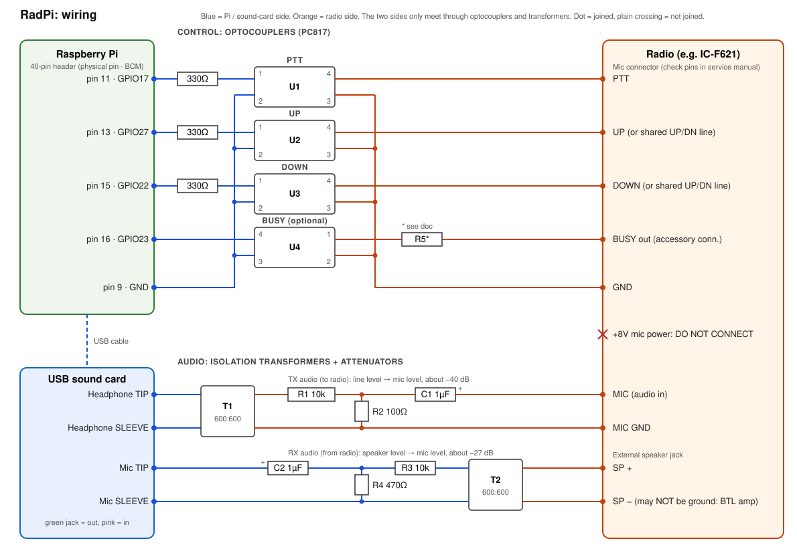

# Hardware & wiring guide

How to connect the Raspberry Pi, USB sound card and interface board to the radio.
It works with any radio whose mic keys (PTT, channel UP, channel DOWN) work by pulling a
line to ground. That covers most land-mobile and UHF CB radios. It was built for an
**Icom IC-F621** (see [IC-F621 notes](#radio-notes-icom-ic-f621)).



> ⚠️ **Identify every radio pin yourself before connecting anything** (section 2).
> Mic-connector pinouts vary between makes and models, and even within one brand.
> Shorting the mic connector's +V supply pin can damage the radio.

---

## 1. Overview

There are three separate circuits, and **none of them connect the Pi's ground directly to the radio**:

| Circuit | Path | Isolation |
|---|---|---|
| Control | Pi GPIO → 330 Ω → optocoupler LED · opto transistor → radio PTT/UP/DOWN to radio GND | PC817 optocouplers U1–U3 |
| Busy (optional) | Radio busy output → opto LED · opto transistor → Pi GPIO23 | PC817 U4 |
| TX audio | Sound-card headphone out → transformer T1 → −40 dB pad → radio MIC | 600:600 transformer |
| RX audio | Radio speaker out → transformer T2 → −27 dB pad → sound-card mic in | 600:600 transformer |

Isolation stops hum and ground loops. It also means a fault on one side can't take out the other.

---

## 2. Identify the radio's pins first

Get the pinout from the radio's **service manual** if you can. If you can't, or to double-check
it, put a breakout (an RJ45 coupler with screw terminals, or a breakout board) **between the
original mic and the radio**. Then, with the radio on, measure each pin's DC voltage against
the radio's chassis or negative supply:

| What you see | It's probably |
|---|---|
| 0 V, and continuity to chassis | **GND** (there may be a separate **MIC GND**: also 0 V) |
| Steady +5 to +9 V that doesn't change with any key | **+V mic supply.** Leave this one alone. |
| ~3–5 V, drops to ~0 V while you hold PTT | **PTT** |
| ~3–5 V, drops when you press UP or DOWN | **UP** / **DOWN** (see "one line or two?" below) |
| A few volts of bias, unaffected by keys, with audio on a scope | **MIC** (audio into the radio) |

**One line or two for UP/DOWN?** If UP and DOWN change **different** pins, you have separate
lines. Wire them as in the diagram. If they change the **same** pin to different voltages, it's
a resistor ladder (section 4.3).

> If PTT works by pulling the **MIC** line low (some radios do this), the simple opto wiring
> won't work. Note it and ask before building.

Probe carefully. A slip between the +V pin and its neighbours can blow a fuse or a track.

Record what you find:

| Function | Radio pin # | Wire colour | Idle voltage | Pressed voltage |
|---|---|---|---|---|
| PTT | | | | |
| UP | | | | |
| DOWN | | | | |
| GND | | | 0 V | |
| MIC | | | | — |
| MIC GND | | | 0 V | — |
| +V (don't use) | | | | — |
| BUSY (accessory, optional) | | | | |

---

## 3. Parts list

| Ref | Qty | Part | Notes |
|---|---|---|---|
| — | 1 | Raspberry Pi (Zero 2 W, 3B+, 4 or 5) | See README for which one |
| — | 1 | USB sound card, **CM108 / CM119** chip | Cheap "USB audio adapter" with green (out) and pink (mic in) 3.5 mm jacks. A Zero needs a micro-USB OTG adapter. |
| U1–U3 | 3 | **PC817** optocoupler | U4 too if you wire BUSY. 4-channel PC817 boards also work (see 4.2). |
| R1x–R3x | 3 | 330 Ω, ¼ W | Opto LED resistors on the GPIO side |
| T1, T2 | 2 | **600:600 Ω audio isolation transformer** | e.g. Bourns SM-LP-5001, or generic "600:600 audio isolation transformer" |
| R1 | 1 | 10 kΩ | TX pad |
| R2 | 1 | 100 Ω (or a 500 Ω trimmer) | TX pad. A trimmer lets you adjust TX level. |
| R3 | 1 | 10 kΩ | RX pad |
| R4 | 1 | 470 Ω (or a 1 kΩ trimmer) | RX pad |
| C1, C2 | 2 | 1 µF film or **bipolar** electrolytic | Blocks mic-bias DC. Bipolar means orientation doesn't matter. |
| R5 | 1 | 1 kΩ–3.3 kΩ | Busy opto LED resistor (section 5). Optional. |
| — | 1 | Mic-connector breakout | Usually an RJ45 breakout with screw terminals, or a sacrificial mic cable |
| — | 1 | 3.5 mm TRS plugs ×2 + leads | To the sound card's jacks |
| — | 1 | 3.5 mm mono plug | For the radio's external speaker jack |
| — | 1 | 12 V → 5 V buck converter, fuse holder + fuse | Only if powering from the radio supply (section 9) |
| — | — | Clip-on ferrites, stripboard, metal case | RF hardening (section 10) |

---

## 4. Control lines: PTT, UP, DOWN

### 4.1 Raspberry Pi header connections

| Pi physical pin | BCM | Function | Connects to | config key |
|---|---|---|---|---|
| **11** | GPIO17 | PTT | 330 Ω → U1 pin 1 | `gpio.ptt_pin: 17` |
| **13** | GPIO27 | Channel UP | 330 Ω → U2 pin 1 | `gpio.up_pin: 27` |
| **15** | GPIO22 | Channel DOWN | 330 Ω → U3 pin 1 | `gpio.down_pin: 22` |
| **16** | GPIO23 | Busy input (optional) | U4 pin 4 (collector) | `gpio.busy_pin: 23` |
| **9** | GND | Pi ground | U1–U3 pin 2, U4 pin 3 | — |

Pin 1 of the header is the square pad, nearest the SD card end. Odd pins are on the inner row.
Other GND pins (6, 14, 20, 25…) work equally well.

GPIO 17/27/22 are **pulled low at power-on**, so the radio can't key up while the Pi boots.
If you move a function to another pin, avoid GPIO 0–8: they're pulled high at boot.

### 4.2 Optocoupler wiring (U1, U2, U3: all the same)

PC817 pinout (dot marks pin 1):

```
        ┌───────┐
 Anode 1│●      │4 Collector
Cathode 2│       │3 Emitter
        └───────┘
```

| Opto pin | Connects to |
|---|---|
| 1 Anode | Pi GPIO via 330 Ω |
| 2 Cathode | Pi GND (pin 9) |
| 4 Collector | Radio PTT / UP / DOWN line |
| 3 Emitter | Radio GND |

When the GPIO goes high (3.3 V), about **6 mA** flows through the LED: (3.3 − 1.2 V) / 330 Ω.
That's safe for the Pi. The opto's transistor then pulls the radio line to ground, just like the
mic's own key. The PC817 can sink several mA, far more than a mic key line needs.

**Polarity:** the collector (pin 4) must go to the line that's **positive** against radio GND
(you measured it in section 2). If it's the wrong way round, the opto does nothing.

**4-channel PC817 module boards:** these usually already have a series resistor on each input
(often 1 kΩ) and an indicator LED. Connect `IN1..IN3` to the GPIOs and `G`/`GND` to Pi GND.
Use each channel's two output terminals as collector → radio line and emitter → radio GND.
At 3.3 V a 1 kΩ input resistor gives only ~1–2 mA. That's usually enough, but if a channel
doesn't trigger reliably, swap the resistor for 330 Ω.

### 4.3 Shared UP/DN line (resistor ladder)

Many mics put UP and DOWN on one line, with a different resistance to ground for each key.
With the radio **off**, measure resistance from the UP/DN pin to GND on the original mic while
holding each key (for example UP = 0 Ω, DOWN = 470 Ω; your radio will differ). Then:

```
Radio UP/DN line ──┬── R_up   ── U2 pin 4    (U2 pin 3 → radio GND)
                   └── R_down ── U3 pin 4    (U3 pin 3 → radio GND)
```

Use a wire link if the measured value is ~0 Ω. Nothing changes in the software: GPIO27 still
means UP and GPIO22 still means DOWN.

### 4.4 Keeping the original mic connected

The opto outputs are "wired-OR" with the mic keys, so the local mic can stay connected in
parallel and both will work. If you do this:
- Use a **straight-through parallel** breakout, with two jacks wired pin-for-pin. Many cheap
  Ethernet "splitters" split the pairs instead.
- During a remote transmission the local mic's audio mixes in with yours. Keep it in its hanger
  or accept some room noise.

### 4.5 Radio programming

The mic UP/DOWN keys must be set to **channel up / channel down** in the radio's programming
software (often under "Mic key" / "Key assignment"). Set these in `config.yaml` to match the
radio's programming:
- `channel.count`: the number of channels in the zone
- `channel.wrap`: whether UP on the last channel goes back to channel 1
- `channel.press_ms` / `gap_ms`: increase these if the radio misses presses

---

## 5. Busy / squelch input (optional)

If the radio has a busy, squelch-open or "carrier detect" output (usually on an accessory
connector, not the mic jack), you can feed it to the Pi for an exact BUSY light. Without it,
the software estimates busy from the RX audio level. That works fine for most uses.

Pi side (both variants): **U4 pin 4 → GPIO23 (pin 16)**, **U4 pin 3 → Pi GND**.
The Pi's internal pull-up holds GPIO23 high, and the opto pulls it low when its LED is lit.

**Variant A: the radio outputs a voltage when busy (active-high logic)**
```
Radio BUSY ── R5 ── U4 pin 1      U4 pin 2 ── radio GND
```
R5 ≈ (V_busy − 1.2 V) / 4 mA. That's 1 kΩ for 5 V, 1.8 kΩ for 8 V, 3.3 kΩ for 13.8 V.

**Variant B: open-collector output that pulls low when busy**
```
Radio +V (accessory pin) ── R5 ── U4 pin 1      U4 pin 2 ── Radio BUSY (open collector)
```

config.yaml:
```yaml
gpio:
  busy_pin: 23
  busy_pull_up: true
  busy_invert: false   # set true if BUSY shows lit when the channel is quiet
```

---

## 6. TX audio: sound card → radio mic input

The sound card's headphone output is **line level** (~0.5–1 V). A mic input expects
**millivolts**. The pad cuts the level by about 40 dB.

| From | To |
|---|---|
| Sound card green jack **TIP** (left channel) | T1 primary, side 1 |
| Sound card green jack **SLEEVE** | T1 primary, side 2 |
| T1 secondary, side 1 | R1 (10 kΩ) → junction A |
| Junction A | R2 (100 Ω) → T1 secondary side 2 |
| Junction A | C1 (1 µF) → **radio MIC** |
| T1 secondary, side 2 | **radio MIC GND** |

- Leave the RING (right channel) unconnected.
- The radio puts a DC bias on the MIC pin to power an electret mic. C1 blocks it. With a
  polarised electrolytic, put **+ towards the radio**.
- To adjust the level, use a 500 Ω trimmer for R2: more resistance gives more level.
- Never connect anything to the mic connector's **+V** pin.

---

## 7. RX audio: radio speaker → sound card mic input

| From | To |
|---|---|
| **Radio ext. speaker SP+** (plug tip) | T2 primary, side 1 |
| **Radio ext. speaker SP−** (plug sleeve) | T2 primary, side 2 |
| T2 secondary, side 1 | R3 (10 kΩ) → junction B |
| Junction B | R4 (470 Ω) → T2 secondary side 2 |
| Junction B | C2 (1 µF) → sound card pink jack **TIP** |
| T2 secondary, side 2 | Sound card pink jack **SLEEVE** |

> ⚠️ **Don't ground either speaker wire.** Many mobile radios use a *bridge-tied (BTL)*
> audio amplifier, where neither speaker terminal is ground. Connecting SP− to GND, or to a
> grounded sound card, can destroy the amplifier. T2 isolates it, so always use the transformer here.

- Plugging into the external speaker jack usually **mutes the internal speaker**. If you also
  want local audio, wire an external speaker in parallel with T2's primary.
- The level follows the radio's **volume knob**. Set it to about a quarter or a third and leave it there.
- CM108 mic inputs put a small bias voltage on the tip. C2 blocks it. With a polarised
  electrolytic, put **+ towards the sound card**.
- A sound card with a true **line-in** (no bias, less sensitive) is even easier. Use a gentler
  pad (e.g. R4 = 4.7 kΩ).

---

## 8. Complete connection list

| # | From | Via | To |
|---|---|---|---|
| 1 | Pi pin 11 (GPIO17) | 330 Ω | U1 pin 1 |
| 2 | Pi pin 13 (GPIO27) | 330 Ω | U2 pin 1 |
| 3 | Pi pin 15 (GPIO22) | 330 Ω | U3 pin 1 |
| 4 | Pi pin 9 (GND) | — | U1 pin 2, U2 pin 2, U3 pin 2, U4 pin 3 |
| 5 | U1 pin 4 | — | Radio PTT |
| 6 | U2 pin 4 | (R_up if ladder) | Radio UP (or UP/DN) |
| 7 | U3 pin 4 | (R_down if ladder) | Radio DOWN (or UP/DN) |
| 8 | U1 pin 3, U2 pin 3, U3 pin 3 | — | Radio GND |
| 9 | Pi pin 16 (GPIO23) | — | U4 pin 4 *(optional)* |
| 10 | Radio BUSY | R5 | U4 pin 1; U4 pin 2 → radio GND *(optional, variant A)* |
| 11 | Pi USB port | (OTG adapter on a Zero) | USB sound card |
| 12 | Sound card out TIP / SLEEVE | — | T1 primary |
| 13 | T1 secondary | R1 / R2 pad, C1 | Radio MIC / MIC GND |
| 14 | Radio SP+ / SP− | — | T2 primary |
| 15 | T2 secondary | R3 / R4 pad, C2 | Sound card mic TIP / SLEEVE |
| 16 | Radio +V mic pin | — | **Nothing** |

---

## 9. Power

- **Mains:** use the official Pi power supply.
- **From the radio's 13.8 V supply:** fused feed (2 A) → good-quality 12 V → 5.1 V buck
  converter → the Pi's USB power input. Ratings:
  - Zero 2 W: 2.5 A or more
  - Pi 4: 3 A
  - Pi 5: 5 A

  Cheap converters radiate switching noise that you'll hear on the audio. Choose a shielded
  one and add ferrites.
- With a shared supply, the Pi and radio grounds meet at the supply negative. That's fine:
  the transformers still stop ground-loop currents through the audio leads.

---

## 10. RF and grounding tips

A UHF transmitter right beside the Pi is the most common cause of trouble: USB audio
dropouts, the Pi rebooting on transmit, or buzz on TX.
- Keep the Pi and sound card **away from the antenna and feedline**. Use a good antenna
  with low SWR.
- Put **clip-on ferrites** on the USB lead, the audio leads and the power lead, at both ends
  if you can.
- Use a **metal case** for the Pi and interface board, with short leads.
- Keep the interface board's Pi side and radio side physically apart, so the isolation
  actually means something.

---

## 11. Software setup and setting levels

1. Find the sound card:
   ```bash
   aplay -l; arecord -l                       # note the card number, e.g. "card 1"
   /opt/radpi/.venv/bin/python -m sounddevice
   ```
   Put part of its name in `config.yaml`, for example `input_device: "USB"` and
   `output_device: "USB"`.

2. Set the mixer (replace `1` with your card number):
   ```bash
   alsamixer -c 1
   ```
   - **F3 (Playback):** Speaker ≈ 70 %
   - **F4 (Capture):** Mic ≈ 50 %, and make sure it's the capture source (red CAPTURE label;
     toggle with Space)
   - **F5 (All):** turn **Auto Gain Control off**. AGC pumps up background noise between overs.
   - Save with `sudo alsactl store`.

3. **RX level:** have someone transmit to the radio. Adjust the radio's volume knob, R4 and the
   capture level until normal speech peaks around **three-quarters** of the UI's RX meter. If
   BUSY flickers on noise, raise `audio.busy_threshold_dbfs` (e.g. to −40).

4. **TX level:** transmit into a dummy load and listen on a second radio, or check deviation
   on a service monitor. Adjust in this order:
   - R2 (trimmer) or alsamixer Speaker, for coarse level
   - `audio.tx_gain`
   - the browser's **Mic gain** slider, for each operator's mic

   Aim for audio as loud as the original mic, without distortion.

---

## 12. Bench test checklist

Do this with the radio into a **dummy load**.

1. **Before connecting the radio:** start the service and press ▲ / ▼ / PTT in the UI. Check
   with a multimeter (continuity mode) that each opto's pins 4–3 close.
2. Connect the radio. Press ▲ / ▼. The radio should step channels. If presses are missed,
   raise `press_ms` / `gap_ms`.
3. Hold PTT. The radio should key. Release it, and it should unkey within ~0.5 s.
4. Unplug the Pi's network while transmitting. The radio must unkey within `hold_timeout_ms`.
5. Hold PTT longer than `max_tx_seconds`. The server must drop PTT.
6. Reboot the Pi with the radio connected. The radio must **not** key up during boot.
7. Check TX audio level and quality (section 11).

---

## Radio notes: Icom IC-F621

- The front-panel mic jack is an 8-pin modular (RJ45-style) connector. Get the PTT, UP/DOWN,
  MIC, GND and +V pins from the IC-F621 service manual, or measure them (section 2). Don't
  rely on another Icom model's pinout.
- Check whether UP/DOWN are separate lines or one resistor-ladder line (section 4.3).
- Make sure the mic UP/DOWN keys are set to channel up/down in the radio's programming.
- Take RX audio from the rear external speaker jack (check the plug size), or from the
  accessory connector if your radio has one with fixed-level AF out and a busy signal.
