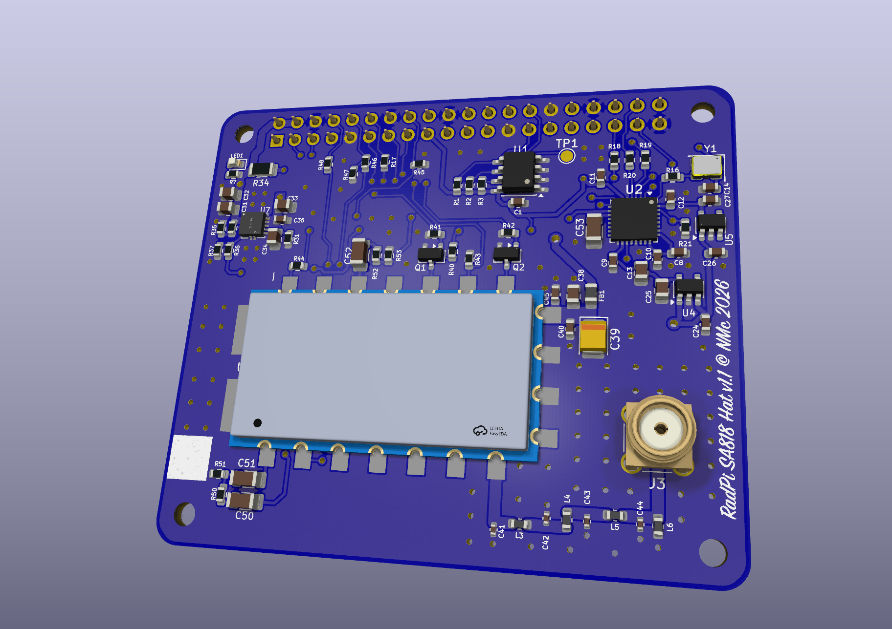

# RadPi SA818 HAT

A Raspberry Pi 4 HAT with a **built-in 1 W UHF FM transceiver**: no external radio. A NiceRF SA818S-U
module (400–480 MHz) is controlled by the Pi over a serial port, with audio through the same
TLV320AIC3104 I2S codec as the [RadPi Control HAT](../pihat/). It's meant for licensed amateur or
experimental use.

  

| Block | What's on the board |
|---|---|
| Transceiver | SA818S-U, frequency, CTCSS/DCS and squelch set over UART (9600 8N1, GPIO14/15) |
| Harmonic filter | 7th-order low-pass tuned for 400–480 MHz (−3 dB at about 550 MHz): 0.45–0.65 dB loss across the band, 0.62 dB at 477 MHz, return loss better than 22 dB, about −57 dB at the 2nd harmonic of 477 MHz (simulated with the parts' Q, ESR, self-resonance and tolerances). Murata LQW18AN 18 nH 2 % wirewound inductors (lowest-resistance 0603 version), Murata GJM high-Q C0G capacitors (5.6 pF ±0.1 pF, 13 pF ±2 %), all 0402 |
| Antenna | Vertical through-hole SMA (Amphenol 132134-11 footprint: any vertical THT SMA jack with legs on a 5.08 mm square), hand-soldered (not fitted by JLC), right at the filter output; the antenna screws on through the top of the case. Footprint for a 220 nH static-bleed inductor (L6, not fitted) |
| Control | PTT via MOSFET (boots in receive), high/low power via open-drain MOSFET, power-down on GPIO27, busy from the module's AudioON on GPIO23 |
| Audio | Codec headphone out → −30 dB → MIC_IN; AF_OUT → −6 dB → codec input. Direct, no transformers (shared ground). C0G coupling capacitors and thin-film resistors |
| Power | **From the Pi's 5 V only** (power the Pi from its USB-C socket; no input of its own). Module: TPS7A94 ultra-low-noise LDO at 4.2 V, then a ferrite + polymer-tantalum pi-filter. Codec: TPS7A2033 (3.3 V analog) and TPS7A2018 (1.8 V digital core), each from 5 V so the digital core's current pulses stay off the analog rail |
| ID EEPROM | AT24C32D, write-protected by default (R3 pull-up); ground test point TP1 while writing it |

## Schematic

The whole circuit on one page (click to open it full size; part and net names are searchable). Labels
with the same name are connected. Regenerate it with `python3 tools/overview.py` after changing the
schematic.

## GPIO use

| Pin | GPIO | Function |
|---|---|---|
| 8 / 10 | 14 / 15 | UART TX / RX to the module |
| 11 | 17 | PTT (high = transmit) |
| 13 | 27 | Module power: high = on, low = sleep (pulled low at boot) |
| 15 | 22 | Low power: high = 0.5 W, low = 1 W |
| 16 | 23 | Busy: low = signal present (`busy_pin: 23`, `busy_pull_up: true`) |
| 12, 35, 38, 40 / 3, 5 / 37 | 18–21 / 2, 3 / 26 | I2S, I2C and reset for the codec |

The Pi 4's main UART is normally used by Bluetooth. Add `dtoverlay=disable-bt` (or `miniuart-bt`) to
`/boot/firmware/config.txt`.

## Files

| File | |
|---|---|
| `sa818s-hat.kicad_pro` / `.kicad_sch` / `.kicad_pcb` | KiCad project (from KiCad's built-in Raspberry Pi HAT template) |
| `sa818s-hat.kicad_sym`, `sa818s-hat.pretty/` | Project library: SA818S symbol and footprint, codec symbol |
| `docs/schematic.svg` | The full schematic on one page (made by `tools/overview.py`) |
| `tools/` | Generator for the sheets (`build.py`) and netlist check (`verify.py`). Uses the shared code in `../kicadgen/` and the power and codec sheets from `../pihat/tools/kicad/` |

## Before layout

- **Power budget** (official 5.1 V 3 A Pi supply): Pi 4 up to about 1.3 A, module 0.65–0.75 A on transmit at
  high power, codec and the rest under 50 mA: about 2.1 A. Power-hungry USB devices on the Pi can tip it over.
- **SA818S footprint:** pad positions agree between two independent footprints (one derived from LCSC/EasyEDA)
  and the datasheet drawing. Print it 1:1 and check a module against it before ordering.
- **RF layout:** 50 Ω grounded coplanar waveguide from the module's ANT pad through the filter to the SMA,
  short and straight, with ground vias beside every filter capacitor and a solid ground plane under the module.
  Leave room for a shield can over the module and filter.
- **Supplies:** place C38/C39/C40/C45 at the module's VBAT pad (C45, 100 pF, nearest the pin). U7 (TPS7A94):
  C31/C32 at IN and C33/C35 at OUT with their grounds together at U7's GND pin, no vias in between; SNS
  (pin 8) Kelvin to C33; thermal pad to a large ground area (about 0.6 W while transmitting).
- **12 MHz codec clock:** its 37th–39th harmonics are 444, 456 and 468 MHz (and 432 MHz). Keep Y1 and the
  MCLK trace (R16, 100 Ω to slow the edges) away from the module and the RF path, with ground pour around them.
  Avoid channels within a few kHz of those frequencies. If they're audible on receive, fit the shield can.
- **L6 (not fitted):** before fitting, measure U6 pin 12 for DC with the module receiving and transmitting into a
  dummy load. Fit it only if it reads 0 V.
- **Check harmonics** on a spectrum analyser after the first build, before connecting an antenna.
- **Frequency range:** the module covers 400–480 MHz (the SA818S-CE is the same module with CE-RED certification). NiceRF only promises power flat within 1 dB up to 470 MHz, so measure the output at your frequency.

## Software

Set `radio.type: sa818` in `config.yaml` (see `config.example.yaml`):

- `channel.list`: name, frequency, optional `tx_freq` for repeaters, `tone` (CTCSS Hz or DCS `D023N`),
  and per-channel bandwidth, squelch or low power.
- The web app shows the frequency and tones, an RSSI bar, and a box to tune any frequency in `sa818.band` (the VFO).
- At start-up the server wakes the module (PD), sets volume, audio filters and tail tone, then the channel.
  If the module stops answering, operators see the error, PTT is refused, and the server retries every 5 s.
- `gpio.busy_pin: 23` uses the module's AudioON as the BUSY indicator.
- RSSI is the module's raw 0–255 reading in 1 dB steps. Set `sa818.rssi_offset_db` after checking it against a
  known signal to show dBm.

Pi 4 set-up: `dtoverlay=disable-bt` in `/boot/firmware/config.txt`, the serial console off and the serial
hardware on (`raspi-config` → Interface Options → Serial Port), then reboot. The installer adds the service user
to `dialout` for `/dev/serial0`.

## Licence

Hardware: CERN-OHL-S v2 (see [`LICENSE`](LICENSE)). The generator scripts are GPL-3.0-or-later (see the
repository root).
